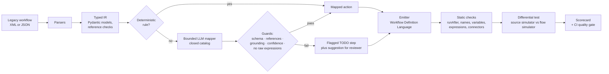

# Workflow Modernization Agent

[](https://github.com/grprakasam/workflow-modernization-agent/actions/workflows/ci.yml)

**Converts legacy XML/JSON workflows into Power Automate cloud-flow drafts, then uses differential testing to check that each draft behaves like the original.**

`Python` · `Pydantic` · `XML/JSON parsing` · `Bounded LLM mapping` · `Power Automate (Workflow Definition Language)` · `Differential testing` · `GitHub Actions`

---

## Why

Microsoft retired SharePoint 2013 workflows in SharePoint Online on **2 April 2026** ([MC542767](https://mc.merill.net/message/MC542767)) and recommends Power Automate as the replacement. SharePoint 2010 workflows were retired earlier. Many teams still run similar flows in Nintex-style tools.

Rebuilding every flow by hand is slow. Translating them with an LLM alone is fast, but nobody can tell whether the result does the same thing. This project takes a middle path:

1. **Deterministic rules** for steps with a clear equivalent.
2. **A bounded LLM** only for steps with no rule. It picks from a closed catalog, and every proposal is validated.
3. **Flag everything else** as a visible TODO. Nothing is guessed silently.
4. **Prove behavior.** Every test case runs through a simulator of the old platform and a simulator of the generated flow, and the two runs must match.

## How it works



| Module | What it does |
|---|---|
| `wma/parsers.py` | Parses XML and JSON into the IR. Validates each step's parameters and checks every reference: declared variables, approval steps, loop items. |
| `wma/ir.py` | Typed IR: trigger, variables, a tree of steps, behavioral test cases. |
| `wma/expr.py` | The legacy expression language (`field:Amount > 5000 and var:Region == 'EU'`). Evaluates it and translates it to Power Automate expressions. |
| `wma/catalog.py` | The closed catalog of Power Automate actions the converter may emit (Outlook, SharePoint, Approvals, Teams, Planner, HTTP, core actions). |
| `wma/mapper.py` | Applies the deterministic rules first and calls the LLM only when no rule fits. |
| `wma/llm_mapper.py` | Bounded LLM mapping with Anthropic or OpenAI, plus an offline fixture provider for CI. |
| `wma/emitter.py` | Builds the flow `definition`: trigger, initialized variables, `If`/`Foreach` scopes, `runAfter` chains, connector actions. |
| `wma/validate.py` | Static checks on the generated definition. |
| `wma/simulate.py` | Two simulators that record observable side effects (emails, list items, approvals, HTTP calls, Teams posts, tasks, delays), final variables and run status. |
| `wma/evaluate.py` | Runs all samples and writes `results/latest_scorecard.md`. |

## Results on the sample set

Twelve sample workflows from finance, HR, IT, procurement, legal, banking operations and clinical operations, with 29 behavioral test cases. Full details are in [`results/latest_scorecard.md`](results/latest_scorecard.md).

| Metric | Rules only (`--llm none`) | Rules + bounded LLM (`--llm fixture`) |
|---|---|---|
| Actions converted automatically | 53 of 65 (82%) | 62 of 65 (95%) |
| Actions flagged for manual rebuild | 12 | 3 |
| Behavioral test cases passed | 14 of 29 | 24 of 29 |
| Workflows behavior-equivalent on every case | 4 of 12 | 9 of 12 |
| **Silent failures** (a case fails but nothing was flagged) | **0** | **0** |
| Static issues in generated flows | 0 | 0 |

The most important number is **silent failures**. Every behavioral difference traces back to a step the converter already flagged: a PowerShell call to Active Directory, an SMS send with no matching connector, and a permissions change outside the catalog. CI fails if this number is ever above zero.

Honest notes:

- The fixture provider returns **hand-written stand-ins** for model replies so CI runs offline (`samples/llm_fixtures.json`). They are not recorded model output. Run `--llm anthropic` or `--llm openai` to measure a real model.
- Review-effort minutes in the scorecard come from heuristic weights in `wma/evaluate.py`. They are estimates, not measurements.
- Generated definitions pass this repo's static checks and simulators. They have **not** been imported into a live Power Automate tenant.

## Guardrails on the LLM step

The model's reply is treated as untrusted data (see [ADR 0005](docs/adr/0005-model-output-is-untrusted.md)). A proposal reaches the flow only if all of these hold:

- The JSON parses and matches the `Proposal` schema.
- The target is a key in the closed catalog (no free-form actions).
- The parameters validate against that target's Pydantic model.
- It contains no raw Power Automate expressions (`@{...}`, `@fn(...)`). Values stay in the source reference syntax and are translated by the emitter.
- It only uses references that exist: declared variables, real approval steps, the loop's own items.
- **Grounding:** it keeps at least half of the source step's values, so the model can't invent content.
- **Confidence** is at least 0.7 (configurable).
- Step content is sent as data in the user message. The system prompt tells the model to ignore instructions found inside it.

Rejected proposals are kept in the TODO placeholder as a suggestion for the reviewer. They are never emitted as actions. Literal `@` characters in source text are escaped (`@@`) so they can't start an expression.

## Quick start

```bash
pip install -e ".[dev]"                 # Python 3.11+
pytest -q                               # 48 tests
python -m wma evaluate                  # writes results/latest_scorecard.md (offline fixtures)
python -m wma convert samples/workflows/invoice_approval.xml --out out
```

Live LLM mapping:

```bash
pip install -e ".[anthropic]"
export ANTHROPIC_API_KEY=...            # optional: WMA_ANTHROPIC_MODEL (default claude-haiku-5-5)
python -m wma evaluate --llm anthropic --out results/live

pip install -e ".[openai]"
export OPENAI_API_KEY=... WMA_OPENAI_MODEL=<model id>
python -m wma evaluate --llm openai --out results/live
```

## Input formats

Both formats map onto the same IR. They are modelled on SharePoint Designer and Nintex-style exports; a real platform export needs a thin adapter onto this schema.

```xml
<Workflow name="invoice-approval">
  <Trigger kind="item_created" site="https://contoso.sharepoint.com/sites/Finance" list="Invoices"/>
  <Variables><Variable name="Status" type="string" default="Pending"/></Variables>
  <Steps>
    <If id="s1" condition="field:Amount > 5000">
      <Then><RequestApproval id="s2" assigned_to="{field:ManagerEmail}" title="Approve {field:Title}"/></Then>
    </If>
  </Steps>
  <TestCases>
    <Case name="large invoice approved">
      <Trigger><Field name="Amount" type="number" value="9800"/></Trigger>
      <Approval step="s2" outcome="Approve"/>
    </Case>
  </TestCases>
</Workflow>
```

```json
{"name": "leave-request", "trigger": {"kind": "item_created", "list": "Leave Requests"},
 "steps": [{"id": "s1", "type": "RequestApproval", "assigned_to": "{field:ManagerEmail}", "title": "Leave"}],
 "cases": [{"name": "approved", "trigger_body": {"ManagerEmail": "lee@contoso.com"}, "approvals": {"s1": "Approve"}}]}
```

**Step kinds**

| Group | Kinds |
|---|---|
| Rules | `SendEmail`, `CreateListItem`, `UpdateListItem`, `HttpRequest`, `RequestApproval`, `Delay`, `SetVariable`, `Terminate`, plus `If` and `ForEach` |
| Bounded LLM | `PostToTeamsChannel`, `CreateTask`, `LogToHistoryList`, `RunPowerShellScript`, `AssignToGroup`, `SendSMS` |

**Triggers:** `item_created`, `item_modified`, `manual`, `schedule`, `http`.

## Output

`definition.json` is the flow's Workflow Definition Language object. It includes the trigger, `InitializeVariable` actions, connector actions with `host.connectionName` and `operationId`, and `metadata.wmaSourceStep` for traceability back to the source. To deploy it, put it in a solution and bind the connection references in your environment.

## Limitations and next steps

- The expression language is deliberately small: comparisons, `and` / `or` / `not`, and templates. Arithmetic, loops over HTTP responses and parallel branches aren't supported yet.
- The simulators model observable side effects, not connector edge cases such as throttling, retries or paging.
- Next steps:
  - An adapter for real SharePoint 2013 XAML and Nintex exports.
  - Packaging output as an importable solution.
  - A live-model run recorded in `results/`.

## Docs

- [Architecture](docs/architecture.md)
- Decisions:
  - [0001 typed IR](docs/adr/0001-typed-ir.md)
  - [0002 rules first, bounded LLM second](docs/adr/0002-rules-first-bounded-llm.md)
  - [0003 differential testing](docs/adr/0003-differential-testing.md)
  - [0004 offline fixtures](docs/adr/0004-offline-fixtures.md)
  - [0005 model output is untrusted](docs/adr/0005-model-output-is-untrusted.md)

## Author

Prakasam R · [github.com/grprakasam](https://github.com/grprakasam) · [linkedin.com/in/grprakasam](https://www.linkedin.com/in/grprakasam)

MIT licence.
