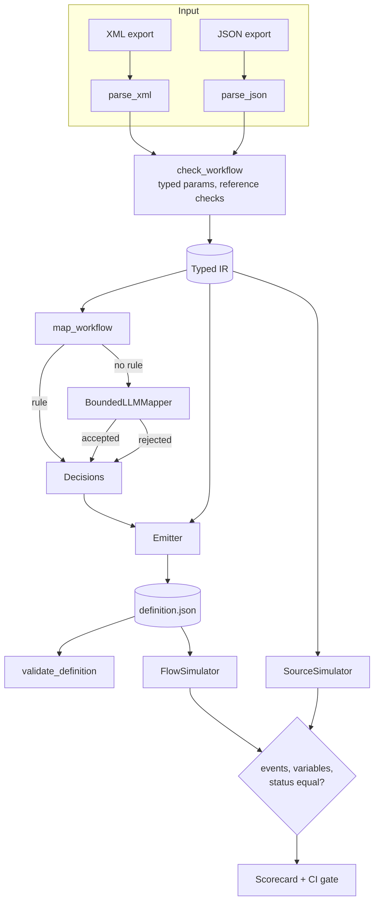

# Architecture

## Data flow

1. **Parse.** Each format has its own parser, and both produce the same `Workflow` model. `check_workflow` validates every step against its parameter model and checks references before anything is mapped:
   - variables must be declared;
   - `approval:` refers to a `RequestApproval` step;
   - `item:` appears only inside `ForEach`.
2. **Map.** `map_workflow` walks the tree:
   - Control steps (`If`, `ForEach`) are structural.
   - Action steps use a deterministic rule when one exists, otherwise the bounded LLM mapper.
   - The result is one `Decision` per step: `rule`, `llm` or `unsupported`, with its issues.
3. **Emit.** The emitter produces Workflow Definition Language:
   - It adds the trigger and one `InitializeVariable` per variable.
   - It emits a `runAfter` chain per scope and nested `If`/`Foreach` scopes.
   - It translates references: `field:` becomes `triggerBody()?[...]`, `var:` becomes `variables(...)`, `item:` becomes `items(<loop>)?[...]` and `approval:` becomes `body(<approval>)?['outcome']`.
   - Unsupported steps become `Compose` placeholders that hold the source step, the issues and any rejected suggestion.
4. **Check.** `validate_definition` checks:
   - top-level shape and unique action names;
   - `runAfter` targets in the same scope;
   - initialized variables;
   - enclosing loops for `items()` and existing actions for `body()`;
   - that connector operations are in the catalog;
   - that every expression parses with supported functions.
5. **Test behavior.** `SourceSimulator` runs the legacy step semantics and `FlowSimulator` runs the generated definition. Both record normalized events. A case passes when events, final variables and run status are all identical.

## Event model

| Source step | Flow action | Event |
|---|---|---|
| `SendEmail` | Outlook `SendEmailV2` | `email{to, subject, body}` |
| `CreateListItem` / `LogToHistoryList` | SharePoint `PostItem` | `sp_create{list, fields}` |
| `UpdateListItem` | SharePoint `PatchItem` | `sp_update{list, item_id, fields}` |
| `RequestApproval` | Approvals `StartAndWaitForAnApproval` | `approval{assigned_to, title}` |
| `PostToTeamsChannel` | Teams `PostMessageToConversation` | `teams{team, channel, message}` |
| `CreateTask` | Planner `CreateTask_V3` | `planner{plan, title, assignee}` |
| `HttpRequest` | `Http` | `http{method, url, body}` |
| `Delay` | `Wait` | `delay{minutes}` |
| `RunPowerShellScript`, `AssignToGroup`, `SendSMS` | none in the catalog | `script`, `permissions`, `sms` (source only) |
